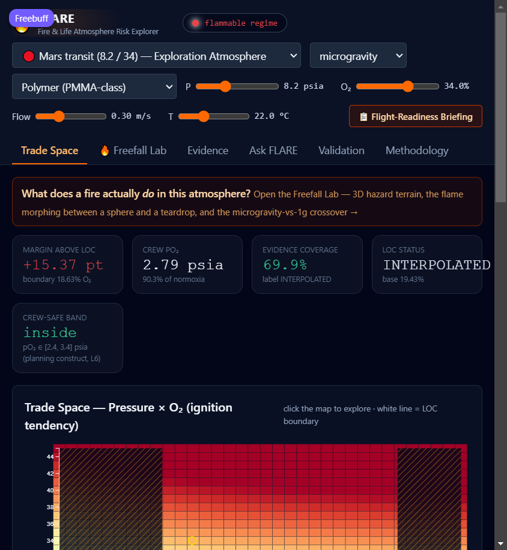
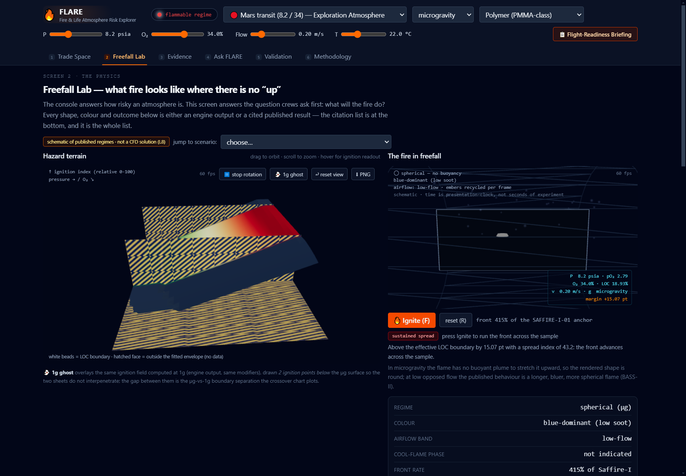
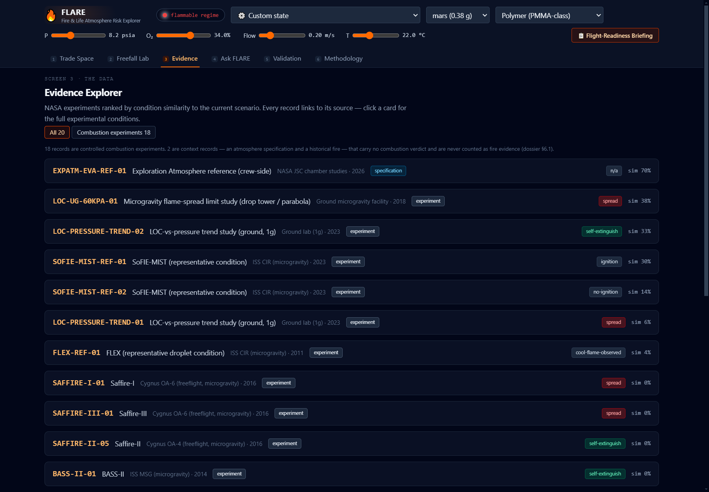

# FLARE — Fire & Life Atmosphere Risk Explorer

[](https://github.com/Amertos/FLARE/actions/workflows/ci.yml)

Decision-support system for spacecraft and habitat atmospheres, built for the
**NASA Space Apps Challenge — "Flame in Freefall"**.

Given an atmosphere state, FLARE answers: *what does NASA's microgravity combustion
experimental record imply about fire behavior and crew physiology, how confident is each
statement, and where does the experimental evidence end?*

## Run it in one click

FLARE ships as **one process behind one URL**: the FastAPI app serves `/api/*` *and*
the built React console from the same origin (`backend/app/static_site.py`), so there is
no second service and no CORS to configure.

| Path | What to do |
|---|---|
| **Public demo** | [Deploy to Render](https://render.com/deploy?repo=https://github.com/Amertos/FLARE) — sign in with GitHub or Google, one web service on the free plan (cold start after 15 min idle) |
| **Vercel** | [Deploy with Vercel](https://vercel.com/new/clone?repository-url=https://github.com/Amertos/FLARE) — `vercel.json` builds the UI and bundles the engine with the function |
| **Local, one command** | `make demo` → <http://localhost:8000> |
| **Docker** | `docker build -t flare . && docker run -p 8000:8000 flare` |

All four run the same code: no demo mode, no mocked data, no cut-down build.

## Screens

| Trade Space | Freefall Lab | Evidence Explorer |
|---|---|---|
|  |  |  |

## How it works — diagrams

Diagram style follows the [diagram-design](https://github.com/cathrynlavery/diagram-design)
constraints: editorial SVG, one accent color, orthogonal 1px connectors, no shadows.
Every figure below is inline SVG — renders on github.com with no image asset, no build step.

### 1 · Architecture — one process, no LLM

<svg xmlns="http://www.w3.org/2000/svg" viewBox="0 0 1000 300" role="img" aria-label="FLARE architecture: React console talks to FastAPI, which calls a pure science engine that reads a curated JSON database; no LLM, no external calls">
  <defs>
    <marker id="a" markerWidth="8" markerHeight="6" refX="7" refY="3" orient="auto"><polygon points="0 0, 8 3, 0 6" fill="#4f5d75"/></marker>
    <marker id="aa" markerWidth="8" markerHeight="6" refX="7" refY="3" orient="auto"><polygon points="0 0, 8 3, 0 6" fill="#bf4520"/></marker>
  </defs>
  <rect width="100%" height="100%" fill="#f5f5f5"/>
  <!-- zone: python process -->
  <rect x="272" y="80" width="396" height="140" rx="8" fill="rgba(45,49,66,0.02)" stroke="rgba(45,49,66,0.10)" stroke-width="0.8"/>
  <rect x="414" y="84" width="112" height="12" rx="2" fill="#f5f5f5"/>
  <text x="470" y="93" fill="rgba(45,49,66,0.40)" font-size="8" font-family="'Geist Mono',monospace" text-anchor="middle" letter-spacing="0.14em">PYTHON PROCESS</text>
  <!-- arrows -->
  <line x1="212" y1="140" x2="316" y2="140" stroke="#bf4520" stroke-width="1.4" marker-end="url(#aa)"/>
  <line x1="476" y1="172" x2="476" y2="196" stroke="#4f5d75" stroke-width="1.2" marker-end="url(#a)"/>
  <rect x="228" y="122" width="80" height="12" rx="2" fill="#f5f5f5"/>
  <text x="268" y="131" fill="#bf4520" font-size="8" font-family="'Geist Mono',monospace" text-anchor="middle" letter-spacing="0.08em">HTTP :8787</text>
  <rect x="486" y="178" width="36" height="12" rx="2" fill="#f5f5f5"/>
  <text x="504" y="187" fill="#4f5d75" font-size="8" font-family="'Geist Mono',monospace" text-anchor="middle" letter-spacing="0.08em">READ</text>
  <!-- node: React console -->
  <rect x="40" y="112" width="172" height="56" rx="6" fill="rgba(79,93,117,0.10)" stroke="#5a6580" stroke-width="1"/>
  <text x="126" y="136" fill="#2d3142" font-size="12" font-weight="600" font-family="'Geist',sans-serif" text-anchor="middle">React console</text>
  <text x="126" y="152" fill="#4f5d75" font-size="9" font-family="'Geist Mono',monospace" text-anchor="middle">8 screens · d3 · three.js</text>
  <!-- node: FastAPI -->
  <rect x="316" y="112" width="144" height="56" rx="6" fill="#ffffff" stroke="#2d3142" stroke-width="1"/>
  <text x="388" y="136" fill="#2d3142" font-size="12" font-weight="600" font-family="'Geist',sans-serif" text-anchor="middle">FastAPI app</text>
  <text x="388" y="152" fill="#4f5d75" font-size="9" font-family="'Geist Mono',monospace" text-anchor="middle">stateless · no I/O</text>
  <!-- node: engine (focal) -->
  <rect x="488" y="112" width="148" height="56" rx="6" fill="rgba(191,69,32,0.08)" stroke="#bf4520" stroke-width="1"/>
  <text x="562" y="136" fill="#2d3142" font-size="12" font-weight="600" font-family="'Geist',sans-serif" text-anchor="middle">Science engine</text>
  <text x="562" y="152" fill="#4f5d75" font-size="9" font-family="'Geist Mono',monospace" text-anchor="middle">loc · hazard · epistemics</text>
  <!-- node: database -->
  <rect x="420" y="196" width="112" height="56" rx="6" fill="rgba(45,49,66,0.05)" stroke="#4f5d75" stroke-width="1"/>
  <text x="476" y="220" fill="#2d3142" font-size="12" font-weight="600" font-family="'Geist',sans-serif" text-anchor="middle">experiments.json</text>
  <text x="476" y="236" fill="#4f5d75" font-size="9" font-family="'Geist Mono',monospace" text-anchor="middle">20 curated records</text>
  <!-- note: no LLM -->
  <text x="836" y="140" fill="#4f5d75" font-size="10" font-family="'Geist Mono',monospace" text-anchor="middle">No LLM.</text>
  <text x="836" y="156" fill="#4f5d75" font-size="10" font-family="'Geist Mono',monospace" text-anchor="middle">No outbound call</text>
  <text x="836" y="172" fill="#4f5d75" font-size="10" font-family="'Geist Mono',monospace" text-anchor="middle">at request time.</text>
  <text x="836" y="188" fill="#4f5d75" font-size="10" font-family="'Geist Mono',monospace" text-anchor="middle">Same input →</text>
  <text x="836" y="204" fill="#4f5d75" font-size="10" font-family="'Geist Mono',monospace" text-anchor="middle">same output.</text>
</svg>

The engine is the accent-colored box: it is the only code that computes anything, and it is
deliberately pure — no I/O, no network, trivially unit-testable. Everything outside it is
delivery.

### 2 · Request flow — a click becomes five numbers

<svg xmlns="http://www.w3.org/2000/svg" viewBox="0 0 1000 260" role="img" aria-label="Request flow: sliders set an atmosphere, the console calls /api/scenario, the engine classifies evidence and computes the Fire Hazard Vector, and the KPI cards render">
  <defs>
    <marker id="f" markerWidth="8" markerHeight="6" refX="7" refY="3" orient="auto"><polygon points="0 0, 8 3, 0 6" fill="#4f5d75"/></marker>
    <marker id="fa" markerWidth="8" markerHeight="6" refX="7" refY="3" orient="auto"><polygon points="0 0, 8 3, 0 6" fill="#bf4520"/></marker>
  </defs>
  <rect width="100%" height="100%" fill="#f5f5f5"/>
  <!-- arrows -->
  <line x1="180" y1="90" x2="260" y2="90" stroke="#4f5d75" stroke-width="1.2" marker-end="url(#f)"/>
  <line x1="420" y1="90" x2="500" y2="90" stroke="#bf4520" stroke-width="1.4" marker-end="url(#fa)"/>
  <line x1="660" y1="90" x2="740" y2="90" stroke="#4f5d75" stroke-width="1.2" marker-end="url(#f)"/>
  <line x1="660" y1="90" x2="660" y2="10" stroke="none"/>
  <path d="M 660,110 Q 660,170 652,170 H 320 Q 312,170 312,162 V 118" fill="none" stroke="#4f5d75" stroke-width="1" stroke-dasharray="4,3" marker-end="url(#f)"/>
  <rect x="440" y="158" width="120" height="12" rx="2" fill="#f5f5f5"/>
  <text x="500" y="167" fill="#4f5d75" font-size="8" font-family="'Geist Mono',monospace" text-anchor="middle" letter-spacing="0.08em">~50 ms</text>
  <!-- Step 1: input -->
  <rect x="40" y="58" width="140" height="64" rx="6" fill="rgba(79,93,117,0.10)" stroke="#5a6580" stroke-width="1"/>
  <rect x="48" y="66" width="28" height="12" rx="2" fill="transparent" stroke="rgba(90,101,128,0.40)" stroke-width="0.8"/>
  <text x="62" y="75" fill="#5a6580" font-size="7" font-family="'Geist Mono',monospace" text-anchor="middle" letter-spacing="0.08em">IN</text>
  <text x="110" y="95" fill="#2d3142" font-size="11" font-weight="600" font-family="'Geist',sans-serif" text-anchor="middle">Five sliders</text>
  <text x="110" y="110" fill="#4f5d75" font-size="9" font-family="'Geist Mono',monospace" text-anchor="middle">8.2 psia · 34% O₂ · µg</text>
  <!-- Step 2: URL/API -->
  <rect x="260" y="58" width="160" height="64" rx="6" fill="#ffffff" stroke="#2d3142" stroke-width="1"/>
  <text x="340" y="95" fill="#2d3142" font-size="11" font-weight="600" font-family="'Geist',sans-serif" text-anchor="middle">GET /api/scenario</text>
  <text x="340" y="110" fill="#4f5d75" font-size="9" font-family="'Geist Mono',monospace" text-anchor="middle">bounded · 422 on garbage</text>
  <!-- Step 3: engine (focal) -->
  <rect x="500" y="58" width="160" height="64" rx="6" fill="rgba(191,69,32,0.08)" stroke="#bf4520" stroke-width="1"/>
  <text x="580" y="88" fill="#2d3142" font-size="11" font-weight="600" font-family="'Geist',sans-serif" text-anchor="middle">Engine computes</text>
  <text x="580" y="103" fill="#4f5d75" font-size="9" font-family="'Geist Mono',monospace" text-anchor="middle">LOC(P) + modifiers →</text>
  <text x="580" y="115" fill="#4f5d75" font-size="9" font-family="'Geist Mono',monospace" text-anchor="middle">5-component vector</text>
  <!-- Step 4: label -->
  <rect x="740" y="58" width="160" height="64" rx="6" fill="rgba(45,49,66,0.05)" stroke="#4f5d75" stroke-width="1"/>
  <text x="820" y="88" fill="#2d3142" font-size="11" font-weight="600" font-family="'Geist',sans-serif" text-anchor="middle">Evidence label</text>
  <text x="820" y="103" fill="#4f5d75" font-size="9" font-family="'Geist Mono',monospace" text-anchor="middle">OBSERVED / INTERPOLATED /</text>
  <text x="820" y="115" fill="#4f5d75" font-size="9" font-family="'Geist Mono',monospace" text-anchor="middle">EXTRAPOLATED / INSUFFICIENT</text>
  <!-- Step 5: response -->
  <rect x="220" y="196" width="210" height="48" rx="6" fill="#ffffff" stroke="#2d3142" stroke-width="1"/>
  <text x="325" y="216" fill="#2d3142" font-size="11" font-weight="600" font-family="'Geist',sans-serif" text-anchor="middle">KPI cards + hazard bars</text>
  <text x="325" y="232" fill="#4f5d75" font-size="9" font-family="'Geist Mono',monospace" text-anchor="middle">margin +15.27 pt · pO₂ 2.79 psia</text>
  <!-- note: same state -->
  <text x="500" y="224" fill="#4f5d75" font-size="9" font-family="'Geist Mono',monospace" text-anchor="middle">URL carries the state — shareable link</text>
</svg>

The dashed return path is the same state flowing back: every number on screen comes from
that single API call, in one deterministic pass.

### 3 · The honesty line — where the data ends

<svg xmlns="http://www.w3.org/2000/svg" viewBox="0 0 1000 320" role="img" aria-label="Evidence trust diagram: observed band around a measurement, interpolated inside the fitted envelope, hatched extrapolation outside it">
  <defs>
    <pattern id="hatch" width="7" height="7" patternUnits="userSpaceOnUse" patternTransform="rotate(45)">
      <rect width="7" height="7" fill="#f5f5f5"/>
      <line x1="0" y1="0" x2="0" y2="7" stroke="#bf4520" stroke-width="1.2" opacity="0.5"/>
    </pattern>
    <marker id="t" markerWidth="8" markerHeight="6" refX="7" refY="3" orient="auto"><polygon points="0 0, 8 3, 0 6" fill="#4f5d75"/></marker>
  </defs>
  <rect width="100%" height="100%" fill="#f5f5f5"/>

  <!-- pressure axis -->
  <line x1="60" y1="240" x2="960" y2="240" stroke="#2d3142" stroke-width="1" marker-end="url(#t)"/>
  <text x="480" y="266" fill="#4f5d75" font-size="10" font-family="'Geist Mono',monospace" text-anchor="middle" letter-spacing="0.10em">CABIN PRESSURE →</text>

  <!-- hatched extrapolation zones (outside envelope) -->
  <rect x="60" y="70" width="230" height="170" fill="url(#hatch)" stroke="rgba(191,69,32,0.4)" stroke-width="1" stroke-dasharray="4,3"/>
  <rect x="720" y="70" width="240" height="170" fill="url(#hatch)" stroke="rgba(191,69,32,0.4)" stroke-width="1" stroke-dasharray="4,3"/>

  <!-- fitted envelope (interpolated zone) -->
  <rect x="290" y="70" width="430" height="170" rx="6" fill="rgba(45,49,66,0.03)" stroke="rgba(45,49,66,0.25)" stroke-width="1"/>

  <!-- LOC boundary line inside the envelope only -->
  <path d="M 300,150 Q 480,120 700,135" fill="none" stroke="#2d3142" stroke-width="2"/>
  <text x="500" y="136" fill="#2d3142" font-size="10" font-family="'Geist Mono',monospace" text-anchor="middle" letter-spacing="0.08em">LOC(P)</text>

  <!-- observed dot -->
  <circle cx="500" cy="120" r="6" fill="#bf4520"/>

  <!-- zone labels -->
  <rect x="96" y="150" width="160" height="34" rx="2" fill="#f5f5f5"/>
  <text x="175" y="163" fill="#bf4520" font-size="10" font-weight="500" font-family="'Geist Mono',monospace" text-anchor="middle" letter-spacing="0.10em">EXTRAPOLATED</text>
  <text x="175" y="177" fill="#4f5d75" font-size="9" font-family="'Geist',sans-serif" text-anchor="middle">hatched — never coloured</text>

  <rect x="424" y="184" width="160" height="34" rx="2" fill="#f5f5f5"/>
  <text x="504" y="197" fill="#4f5d75" font-size="10" font-weight="500" font-family="'Geist Mono',monospace" text-anchor="middle" letter-spacing="0.10em">INTERPOLATED</text>
  <text x="504" y="211" fill="#4f5d75" font-size="9" font-family="'Geist',sans-serif" text-anchor="middle">inside the fitted envelope</text>

  <rect x="752" y="150" width="160" height="34" rx="2" fill="#f5f5f5"/>
  <text x="832" y="163" fill="#bf4520" font-size="10" font-weight="500" font-family="'Geist Mono',monospace" text-anchor="middle" letter-spacing="0.10em">EXTRAPOLATED</text>
  <text x="832" y="177" fill="#4f5d75" font-size="9" font-family="'Geist',sans-serif" text-anchor="middle">hatched — never coloured</text>

  <!-- observed annotation -->
  <rect x="530" y="92" width="180" height="30" rx="2" fill="#f5f5f5"/>
  <text x="620" y="105" fill="#bf4520" font-size="10" font-weight="500" font-family="'Geist Mono',monospace" text-anchor="middle" letter-spacing="0.10em">OBSERVED</text>
  <text x="620" y="117" fill="#4f5d75" font-size="9" font-family="'Geist',sans-serif" text-anchor="middle">measurement within tolerance</text>
  <line x1="510" y1="114" x2="530" y2="106" stroke="#bf4520" stroke-width="1"/>

  <!-- title strip -->
  <text x="60" y="44" fill="rgba(45,49,66,0.40)" font-size="9" font-family="'Geist Mono',monospace" letter-spacing="0.18em">TRUST BOUNDARY · EPSTEMICS MODULE</text>
  <text x="60" y="32" fill="#2d3142" font-size="13" font-weight="600" font-family="'Geist',sans-serif">Where the NASA data ends, FLARE stops colouring — it hatches</text>
</svg>

This one diagram is the thesis. Every pixel outside the fitted envelope (50–101.3 kPa)
gets the same treatment: hatched, labelled, never a confident color. The engine refuses
to imply evidence where there is none — that refusal lives in `epistemics.py` and is
enforced in the render layer.

### 4 · Fire Hazard Vector — five numbers, never one

<svg xmlns="http://www.w3.org/2000/svg" viewBox="0 0 720 240" role="img" aria-label="Five hazard components: ignition, spread, persistence, heat release, extinction margin; four solid bars and one derived-bar annotation">
  <rect width="100%" height="100%" fill="#f5f5f5"/>

  <text x="40" y="32" fill="rgba(45,49,66,0.40)" font-size="9" font-family="'Geist Mono',monospace" letter-spacing="0.18em">COMPONENT VALUE 0–100 · 8.2 psia / 34% O₂ / µG</text>

  <!-- bars: ignition (height) / spread (height) / persistence (height) / heat release (height) / extinction margin (height) -->
  <g font-family="'Geist',sans-serif" font-size="10" fill="#2d3142">
    <text x="52" y="78">Ignition</text>
    <text x="212" y="78">Spread</text>
    <text x="372" y="78">Persistence</text>
    <text x="532" y="78" text-anchor="start">Heat release</text>
  </g>

  <!-- bar backgrounds -->
  <g fill="rgba(45,49,66,0.08)">
    <rect x="52" y="88" width="80" height="8" rx="2"/>
    <rect x="212" y="88" width="80" height="8" rx="2"/>
    <rect x="372" y="88" width="80" height="8" rx="2"/>
    <rect x="532" y="88" width="80" height="8" rx="2"/>
  </g>

  <!-- bar fills (accent only on ignition, the story) -->
  <rect x="52" y="88" width="60" height="8" rx="2" fill="#bf4520"/>
  <rect x="212" y="88" width="43" height="8" rx="2" fill="#4f5d75"/>
  <rect x="372" y="88" width="40" height="8" rx="2" fill="#4f5d75"/>
  <rect x="532" y="88" width="46" height="8" rx="2" fill="#4f5d75"/>

  <!-- numbers -->
  <g font-family="'Geist Mono',monospace" font-size="10" fill="#2d3142">
    <text x="52" y="110">60</text>
    <text x="212" y="110">43</text>
    <text x="372" y="110">40</text>
    <text x="532" y="110">46</text>
  </g>

  <!-- rule -->
  <line x1="40" y1="140" x2="680" y2="140" stroke="rgba(45,49,66,0.10)" stroke-width="0.8"/>

  <text x="40" y="166" fill="#4f5d75" font-size="10" font-family="'Geist',sans-serif">Why five and not one: two atmospheres with the same single risk number behave differently</text>
  <text x="40" y="182" fill="#4f5d75" font-size="10" font-family="'Geist',sans-serif">at different physics — the ignition component tracks flammability, the persistence</text>
  <text x="40" y="198" fill="#4f5d75" font-size="10" font-family="'Geist',sans-serif">component tracks how long a fire keeps going. Averaging them back into one number</text>
  <text x="40" y="214" fill="#4f5d75" font-size="10" font-family="'Geist',sans-serif">would destroy the comparison the vector exists to make.</text>
  <text x="40" y="234" fill="#bf4520" font-size="9" font-family="'Geist Mono',monospace" letter-spacing="0.08em">PERSISTENCE AND HEAT RELEASE ARE DERIVED FROM SPREAD — NOT INDEPENDENT MEASUREMENTS (LIMIT L4)</text>
</svg>

The trade it makes visible: **10.0 psia / 30% O₂ and 7.5 psia / 40% O₂ deliver the same
pO₂ (3.00 psia) and different fire behavior.** Crew-equivalent atmospheres are not
fire-equivalent, and the flammability boundary is set by molar O₂ against LOC — not by pO₂.

## What it does

- **Trade Space** — pressure × O₂ map with the LOC (limiting oxygen concentration)
  flammability boundary, a crew-safe band, and a hatched "no NASA data" extrapolation zone.
  Click the map to move the atmosphere.
- **Freefall Lab** — the same state, drawn: a rotatable 3D hazard surface with the LOC
  boundary as a ridge and the edge of the fitted envelope as a hatched cliff; a flame chamber
  whose fire morphs between a sphere (no buoyancy) and a teardrop (buoyant plume) and *dies*
  below the boundary, driven by `/api/flame`; and the microgravity-vs-1g margin crossover that
  makes "space burns slower" visibly false. Every shape, colour and outcome is an engine output
  or a cited published result, listed under the figure. The 3D is a schematic of published
  regimes, not a CFD solution (limitation L8) — `?no3d=1` renders the whole screen as numbers.
- **Candidate atmospheres** — fire safety vs EVA-benefit Pareto frontier with a weight
  slider that changes which option leads, and a deliberate control pair (12 psia at 21% vs
  28% O₂) where one option buys no EVA benefit and is shown as dominated.
- **Evidence Explorer** — experiment cards (Saffire, BASS-II, SoFIE-MIST, …) ranked by
  condition similarity, each labelled `experiment` / `historical` / `specification` and
  linked to its real source (NTRS / PMC / journal / NASA History).
- **Ask FLARE** — type a question; an explicit keyword router picks the intent and the
  answer is composed from engine outputs. Every citation ID is verified server-side against
  the database, fabricated ones are dropped rather than shown, and cited chips jump to the
  record. Runs offline with no LLM key — **no language model is called anywhere in this build**.
- **Validation** — leave-one-out backtest of the engine against NASA's own held-out
  experiments, misses included with explanations.
- **Countermoves** — ranked, engine-computed fire-safety levers for the current atmosphere
  (cool cabin, material substitution, reduce microgravity airflow, trade O₂ down to the crew
  floor): each lever reports its own before/after hazard vector and names the dossier-backed
  quantity that produced its effect; levers the model cannot support in this regime are shown
  not-applicable **with the reason**, never as a silent zero-delta. Directly answers the
  challenge's "how do we reduce the fire risk" question without inventing a new model.
- **Methodology** — the known-limitations list, the work that is deliberately *not* built,
  the model-governance rules and the data-provenance table, served from the engine so the
  product and the written record cannot drift apart.
- **Export memo** — any atmosphere as a one-page Markdown decision memo (state, label,
  hazard vector, boundary derivation, crew side, cited sources, sensitivity sweep,
  backtest, limitations).
- **Shareable state** — the address bar always carries the atmosphere and the open screen,
  so a specific state can be handed to a reviewer as a link.

## Design rules (enforced in code)

1. No single fire-risk number — outputs are a 5-component Fire Hazard Vector.
2. Every output carries an evidence label: Observed / Interpolated / Extrapolated / Insufficient.
3. Every experiment record links to its source.
4. The engine is deterministic, and **no language model is called anywhere in this build**.
   Answers are composed from engine outputs and database records, steered by an explicit
   question router whose decision is returned with the answer; every citation ID is verified
   server-side and fabricated ones are flagged rather than shown.
5. The flammability boundary is rendered only where the LOC curve was calibrated. Outside that
   envelope the map is hatched, not coloured, so no pixel implies evidence that does not exist.
6. Records without a combustion verdict are never presented as fire evidence (dossier §6.1).
7. A visualization may only draw what the engine computes or a source states. The 3D screen is
   labelled a schematic of published regimes, not a simulation, and returns its citations with
   the geometry (limitation L8).

## Repository layout

```
docs/                      submission package, validation dossier, implementation plan,
                           demo script, security notes
backend/
  engine/                  pure science layer (no I/O)
    loc.py                 LOC(P) boundary + gravity/flow/temperature modifiers
    hazard.py              Fire Hazard Vector derivation
    epistemics.py          Observed/Interpolated/Extrapolated/Insufficient + coverage
    records.py             experiment / historical / specification record taxonomy
    intents.py             question routing + intent-specific answer composition
    backtest.py            leave-one-out backtest used by the API and the answers
    pareto.py              non-dominated sort
    similarity.py          experiment-to-query similarity ranking
    citations.py           server-side citation verification
    flame.py               flame regime, front fate and the ug-vs-1g crossover (3D screen)
  data/experiments.json    curated seed database (20 source-linked records)
  app/main.py              FastAPI endpoints
  app/report.py            one-page Markdown decision memo
  app/methodology.py       known limitations, future work and provenance served to the UI
  tools/                   reproduce_dossier_log.py — regenerates the published test log
  tests/                   engine + API + router + memo tests asserting the dossier values
frontend/
  src/screens/             TradeSpace, Countermoves, DesignSearch, Freefall, EvidenceExplorer, AIScientist, Validation, Methodology
  src/viz/                 three.js + SVG views: hazard terrain, flame chamber, crossover chart
  src/api.ts               typed REST client
.github/workflows/ci.yml   tests + dossier log + frontend build on every push
LICENSE                    MIT
```

## Running it

Backend (port 8787):

```bash
py -m pip install -r backend/requirements.txt
py -m uvicorn backend.app.main:app --port 8787
```

Frontend (port 5173):

```bash
cd frontend
npm install
npm run dev        # dev server
npm run build      # production build
```

Whole product on one port (builds the UI, then serves API + UI from one process):

```bash
make demo          # http://localhost:8000
```

Tests (131 currently):

```bash
py -m pytest backend/tests -q
```

Regenerate the published test log in [docs/SCIENTIFIC-VALIDATION-DOSSIER.md](docs/SCIENTIFIC-VALIDATION-DOSSIER.md) §6 from the shipped code:

```bash
py -m backend.tools.reproduce_dossier_log
```

CI runs both, plus the frontend build, on every push — see [.github/workflows/ci.yml](.github/workflows/ci.yml).

## Documentation

- [docs/SUBMISSION.md](docs/SUBMISSION.md) — submission package: challenge mapping, what is
  novel, judging-criteria pointers, verification steps.
- [docs/SCIENTIFIC-VALIDATION-DOSSIER.md](docs/SCIENTIFIC-VALIDATION-DOSSIER.md) — full
  derivations, provenance table, and the executed test log.
- [docs/IMPLEMENTATION-PLAN.md](docs/IMPLEMENTATION-PLAN.md) — build order and scope gates.
- [docs/demo-script.md](docs/demo-script.md) — 4-minute demo script.
- [docs/SECURITY-NOTES.md](docs/SECURITY-NOTES.md) — security pass: surface, enforced
  controls, accepted risks, and how each control was checked.

## Scope

FLARE supports **relative comparison of atmospheres**. It is not an absolute risk assessor and
never issues operational commands. The angles it does not model — smoldering, radiation–convection
coupling, absolute HRR for cabin scale — are listed in the product itself
(Methodology → Known limitations) rather than hidden in a footnote.
